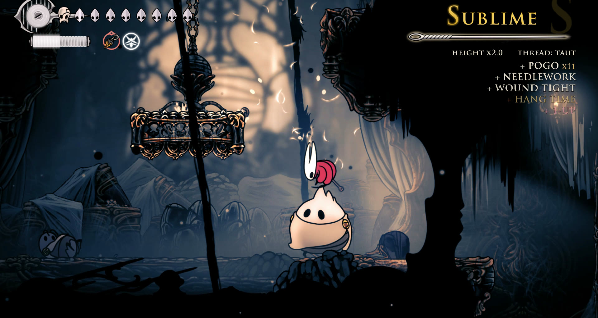
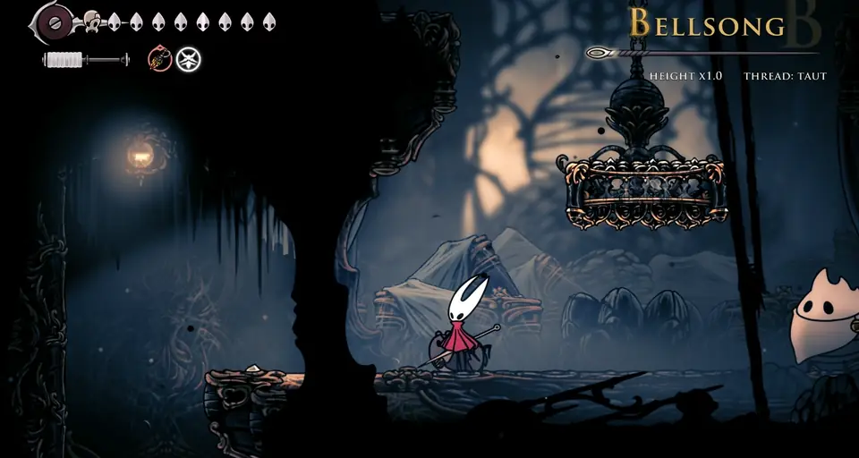
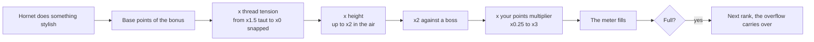
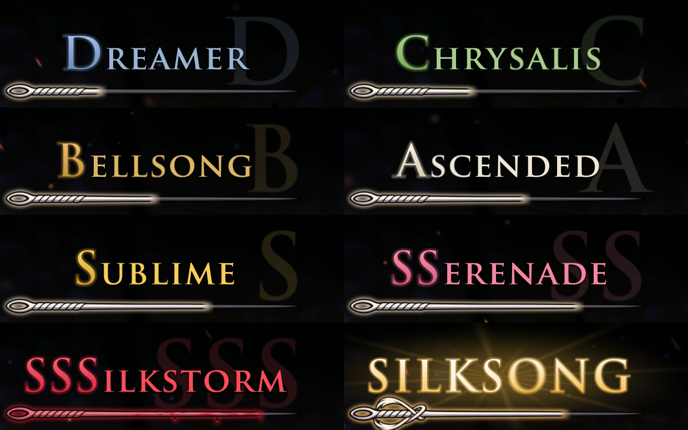
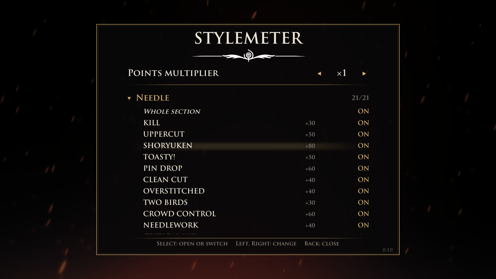

<p align="center">
  
</p>

<h1 align="center">Stylemeter</h1>

<p align="center">
  <b>A style meter for Hollow Knight: Silksong.</b><br>
  Fight with flair and climb eight ranks, from DREAMER to SILKSONG.
</p>

<p align="center">
  <a href="https://github.com/GlowyStar/silksong-stylemeter/releases"></a>
  
  
  <a href="https://github.com/GlowyStar/silksong-stylemeter/actions/workflows/ci.yml"></a>
  <a href="LICENSE"></a>
</p>

<p align="center">
  <a href="#install">Install</a> |
  <a href="#how-scoring-works">How scoring works</a> |
  <a href="docs/BONUSES.md">All bonuses</a> |
  <a href="#settings">Settings</a> |
  <a href="#faq">FAQ</a> |
  <a href="README.ru.md">Русская версия</a>
</p>

---

Stylemeter watches how Hornet fights and rates it the way character action games do. Every hit, kill, pogo, parry,
tool trick and boss win is a named bonus. Keep them varied and keep them coming, and the needle in the corner fills
up rank by rank. Repeat the same move, get hit or stand idle, and it drains away.

<p align="center">
  
  <br><sub>A real pogo chain in game: BELLSONG, ASCENDED, SUBLIME, SSERENADE, then the kill.</sub>
</p>

> **Beta.** Everything below works and has been played through, and the scoring rules have automated tests. It
> has not yet met many players, so balance may still change. Bug reports and ideas are welcome in
> [Issues](https://github.com/GlowyStar/silksong-stylemeter/issues).

## Features

- **About 250 named bonuses in 14 sections:** needle work, air and movement, clashes and parries, silk skills,
  crests, attack tools, support tools, Needolin, healing, elements and the world, enemies, a named win for every
  boss, multikills and combos, streaks. [The full catalog](docs/BONUSES.md).
- **Thread tension.** A move that keeps scoring wears its thread and pays less; switching between needle, tools
  and skills keeps every thread taut.
- **Height.** Every scoring action in the air raises a multiplier up to x2 until Hornet lands.
- **Bosses** double every bonus, and each boss has its own named victory.
- **Pressure.** Getting hit costs a rank. The higher the rank, the faster the meter drains; SILKSONG melts in about
  five seconds unless you keep it fed.
- **A reward for holding the top:** one silk for every five seconds at SILKSONG (can be turned off).
- **Settings in the game:** a panel in Options with the points multiplier and a switch for every bonus.
- **Looks like it belongs:** a hand-drawn needle that fills as you score, rank names in the game's own lettering,
  a bloodied needle at SSSILKSTORM and a divine glow at SILKSONG.
- **Safe:** no save is touched, nothing goes online, and a game update that changes something the mod reads only
  switches off the bonus that needs it.

## How scoring works



Not every bonus takes every multiplier: actions (hits and kills) take all of them, moves (clashes, pogos, binds)
take height and boss but never wear a thread, and flat bonuses (streaks, arena clears) count as they are.

| Thread | When | Pays |
|---|---|---|
| Taut | fresh, or rested while other threads scored | x1.5 |
| Worn | used a lot lately | x1 |
| Frayed | used over and over | x0.5 |
| Snapped | nothing but this move | x0 |

Threads recover over time and whenever another one scores. With only one or two ways to fight they never drop
below Worn, and with three or four never below Frayed, so a build with few tools is not punished. The details, with
every number, are in [docs/MECHANICS.md](docs/MECHANICS.md).

### The ranks



| Rank | Points to fill | Drain per second |
|---|---|---|
| DREAMER | 200 | 7.2 |
| CHRYSALIS | 300 | 9.1 |
| BELLSONG | 400 | 11 |
| ASCENDED | 500 | 13 |
| SUBLIME | 700 | 26 |
| SSERENADE | 850 | 32.5 |
| SSSILKSTORM | 1000 | 44 |
| SILKSONG | 1500 | 300 |

The meter does not drain in menus, cutscenes, dialogue, scene transitions or on a bench.

### The meter on screen


- **The rank** in the game's lettering, with its initial large behind it.
- **The needle** fills with the current rank; at SSSILKSTORM it is bloodied, at SILKSONG it turns into the rapier.
- **HEIGHT** shows the air multiplier, **THREAD** the tension of the move you just used.
- **The feed** lists the latest bonuses, newest on top; a repeat stacks as `x3`. The colour tells the base points:
  white below 100, gold from 100, rose from 200, red from 300.

<br clear="right">

### A taste of the catalog

| Section | Some of its bonuses (base points) |
|---|---|
| Needle | PIN DROP 60, SHORYUKEN 80, INSULT TO INJURY 80, BIG KILL 100, TOASTY! 50 |
| Air and movement | POGO 15 each, HANG TIME 100, SKY HIGH 150, 1-UP 200, RUN, FORREST, RUN! 60 |
| Clashes and parries | CLASH 50, RIPOSTE 150 |
| Crests | OLD HABITS 80, CAT'S CRADLE 100 |
| Tools | BOOMERANG 60, TRICK SHOT 120, GLASS CANNON 150, DEATH DEFIANCE 200 |
| Elements and world | KABOOM 45, THIS IS SPARTA! 150 |
| Enemies | STOP, THIEF! 80, PARRY THIS! 100, THREAD THE NEEDLE 120 |
| Bosses | a named win for each, up to CUT THE CORD 1000; FLAWLESS VICTORY 400 |
| Multikills | DOUBLE KILL 50, TRIPLE KILL 100, ULTRAKILL 200, RAMPAGE 300 |
| Streaks | ZERO TO HERO 300, and GIT GUD for when it goes wrong |

What each one asks of you: [docs/BONUSES.md](docs/BONUSES.md).

## Settings

Open **Options > Stylemeter**, from the title screen or the pause menu.

<p align="center">
  
</p>

- **Points multiplier** from x0.25 to x3: every point of every bonus is multiplied by it. Lower it for a harder
  meter, raise it to see the high ranks more often.
- **Bonuses** by section: open a section to switch single bonuses, or use **Whole section** for all of it.

It works with a gamepad, the keyboard and the mouse, and every change is saved at once. The same settings live in
`BepInEx/config/com.glowystar.stylemeter.cfg`, together with:

| Setting | Default | What it does |
|---|---|---|
| `Meter.Enabled` | `true` | Count style points at all |
| `Meter.ShowOverlay` | `true` | Show the meter on screen |
| `Meter.SilkReward` | `true` | One silk for every five seconds at SILKSONG |
| `Meter.PointsMultiplier` | `1` | Same as the panel, 0.25 to 3 |
| `Bonuses.Disabled` | empty | Bonuses switched off, by name, separated by `\|` |
| `Debug.LogStyle` | `true` | Write bonuses and rank changes to `BepInEx/Stylemeter/logs` |

## Install

You need Hollow Knight: Silksong on Windows (the Steam version is the one tested) and
[BepInEx 5](https://github.com/BepInEx/BepInEx/releases), the usual mod loader for Unity games.

1. **Find the game folder.** In Steam: right click the game, **Manage > Browse local files**. It is the folder with
   `Hollow Knight Silksong.exe`.
2. **Install BepInEx 5.** Download `BepInEx_win_x64_5.4.23` or newer from its
   [releases](https://github.com/BepInEx/BepInEx/releases) (the x64 build of version 5, not 6), unpack it into the
   game folder and start the game once, so BepInEx creates its folders. Close the game.
3. **Install Stylemeter.** Download `Stylemeter-0.3.0.zip` from
   [Releases](https://github.com/GlowyStar/silksong-stylemeter/releases) and unpack it into the game folder. The
   plugin ends up in `BepInEx/plugins/Stylemeter/Stylemeter.dll`.
4. **Play.** Start the game: Options now has a **Stylemeter** entry, and the meter appears as soon as Hornet scores.

The game folder should then look like this:

```text
Hollow Knight Silksong/
  Hollow Knight Silksong.exe
  winhttp.dll                 (from BepInEx)
  BepInEx/
    plugins/
      Stylemeter/
        Stylemeter.dll
```

To check the download, compare its SHA-256 with the `.sha256` file next to it on the release page:

```powershell
Get-FileHash .\Stylemeter-0.3.0.zip -Algorithm SHA256
```

**Update:** unpack the new zip over the old one. **Uninstall:** delete `BepInEx/plugins/Stylemeter` (and, if you
like, `BepInEx/config/com.glowystar.stylemeter.cfg` and `BepInEx/Stylemeter`).

## FAQ

**The meter does not show up.** Open `BepInEx/LogOutput.log` and look for `Stylemeter 0.3.0 loaded`. If the line
is missing, BepInEx is not running: check that `winhttp.dll` sits next to the game's exe. If it is there, check
that `Meter.Enabled` and `Meter.ShowOverlay` are `true`. The meter stays hidden until Hornet scores.

**Does it change the game?** Only the meter is added. The single exception is the silk reward at SILKSONG, which
you can switch off (`Meter.SilkReward`). Saves are never touched.

**Achievements?** They work as usual.

**Other mods?** Stylemeter hooks a handful of game methods with Harmony and should sit next to most BepInEx mods.

**A game update came out.** If it renamed something the mod reads, the mod keeps running, switches off only the
bonuses that depend on it and writes which ones to the BepInEx log.

**Where are the logs?** Each session writes the bonuses and rank changes to `BepInEx/Stylemeter/logs`: the ten
newest sessions there, older ones in `logs/old`, which keeps 200. Turn it off with `Debug.LogStyle = false`.

## Build from source

You need the [.NET SDK](https://dotnet.microsoft.com/download) 10 and the game with BepInEx installed: the plugin
compiles against the game's own assemblies, which are not part of this repository.

```powershell
./tools/build.ps1                              # Release build and the scoring tests
./tools/build.ps1 -Install                     # also copy the plugin into the game
./tools/build.ps1 -GameDir "D:\Games\Hollow Knight Silksong"
./tools/release.ps1                            # dist/Stylemeter-<version>.zip and its SHA-256
```

`-Configuration Dev` builds the developer version with a sandbox save slot, a command bridge for automated tests
and research logs. Release builds contain none of it.

| Folder | What is in it |
|---|---|
| `src/Stylemeter/Core` | The scoring engine: plain C#, no Unity, covered by the tests |
| `src/Stylemeter/Game` | Hooks into the game, the meter on screen and the settings panel |
| `src/Stylemeter/Dev` | Developer tools, compiled only into the Dev build |
| `src/Stylemeter.Sim` | Rule tests for the engine: `dotnet run --project src/Stylemeter.Sim -c Release -- test` |

The version lives in one place, `src/Directory.Build.props`.

## Credits

- Mod and needle art: [GlowyStar](https://github.com/GlowyStar).
- The ranks, the needle and the silk reward are themed on Silksong's world; the idea of a style meter comes from
  character action games.
- Hollow Knight: Silksong belongs to Team Cherry. This mod is not affiliated with or endorsed by them.

## License

[MIT](LICENSE).
