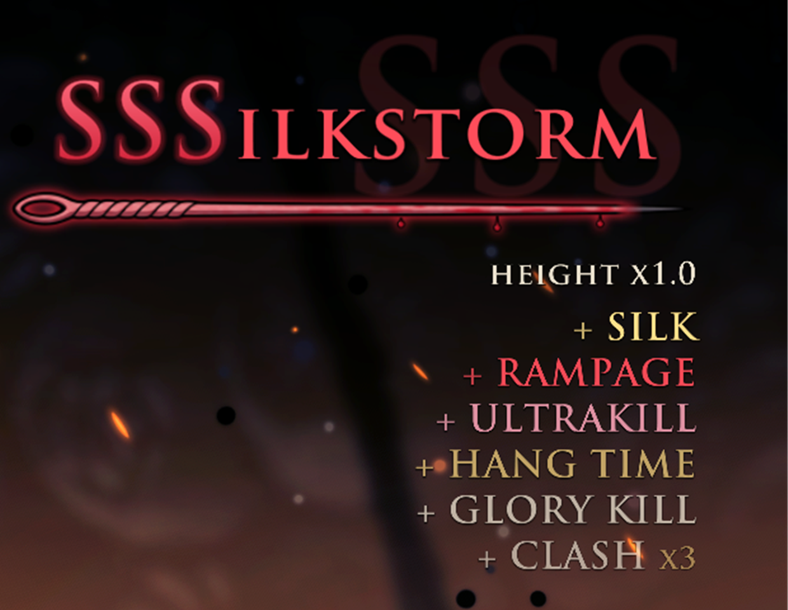

# Stylemeter

A style meter for Hollow Knight: Silksong. Fight with flair and the meter climbs through eight ranks, from DREAMER
to SILKSONG; repeat yourself, get hit or stand idle and it drains away.

[Русская версия](README.ru.md)


## What it rates

- About 250 named bonuses in 14 sections: needle work, air and movement, clashes and parries, silk skills, crests,
  tools, Needolin, healing, elements and the world, enemies, every boss, multikills and combos, streaks.
- Thread tension: a move that keeps scoring wears thin and pays less, so variety pays.
- Height: every scoring action in the air raises a multiplier up to x2 until Hornet lands.
- Bosses double every bonus; each boss has its own named victory.
- Getting hit costs a rank. The meter drains faster the higher it climbs, and SILKSONG melts in about five seconds.
- Holding SILKSONG pays: one silk for every five seconds held (can be turned off).

The meter sits in the top right corner: the rank, the needle that fills and a feed of the latest bonuses, gold for
the rare ones and red for the rarest.



## Settings

Open **Options > Stylemeter** in the game, from the title screen or the pause menu. The panel is in English, like
the bonus names:


- **Points multiplier** from x0.25 to x3: every point of every bonus is multiplied by it.
- **Bonuses** by section: open a section to switch single bonuses or the whole section on and off.

It works with a gamepad, the keyboard and the mouse. The same settings live in
`BepInEx/config/com.glowystar.stylemeter.cfg`, together with:

| Setting | Default | What it does |
|---|---|---|
| `Meter.Enabled` | `true` | Count style points at all |
| `Meter.ShowOverlay` | `true` | Show the meter on screen |
| `Meter.SilkReward` | `true` | Silk for holding SILKSONG |
| `Meter.PointsMultiplier` | `1` | Same as the menu, 0.25 to 3 |
| `Bonuses.Disabled` | empty | Bonuses switched off, by name, separated by `\|` |
| `Debug.LogStyle` | `true` | Write bonuses and rank changes to `BepInEx/Stylemeter/logs` |

## Install

1. Install [BepInEx 5](https://github.com/BepInEx/BepInEx/releases) (5.4.23 or newer, x64) into the game folder and
   start the game once.
2. Unpack `Stylemeter-<version>.zip` into the game folder, so the plugin ends up in
   `BepInEx/plugins/Stylemeter/Stylemeter.dll`.

To remove the mod, delete `BepInEx/plugins/Stylemeter`.

The mod does not touch saves and never goes online. It writes only its config file and its session logs in
`BepInEx/Stylemeter/logs`: the ten newest sessions there, older ones in `logs/old`, which keeps 200.

## Build from source

You need the [.NET SDK](https://dotnet.microsoft.com/download) 10 and the game with BepInEx installed: the plugin
compiles against the game's own assemblies, which are not part of this repository.

```powershell
./tools/build.ps1                              # Release build and the scoring tests
./tools/build.ps1 -Install                     # also copy the plugin into the game
./tools/build.ps1 -GameDir "D:\Games\Hollow Knight Silksong"
./tools/release.ps1                            # dist/Stylemeter-<version>.zip and its SHA-256
```

`-Configuration Dev` builds the developer version with a sandbox save slot, a command bridge for automated tests and
research logs. Release builds contain none of it.

| Folder | What is in it |
|---|---|
| `src/Stylemeter/Core` | The scoring engine: plain C#, no Unity, fully covered by the tests |
| `src/Stylemeter/Game` | Hooks into the game, the meter on screen and the settings menu |
| `src/Stylemeter/Dev` | Developer tools, compiled only into the Dev build |
| `src/Stylemeter.Sim` | Rule tests for the engine: `dotnet run --project src/Stylemeter.Sim -c Release -- test` |

The version lives in one place, `src/Directory.Build.props`.

## License

MIT, see [LICENSE](LICENSE). Hollow Knight: Silksong belongs to Team Cherry; this mod is not affiliated with them.
