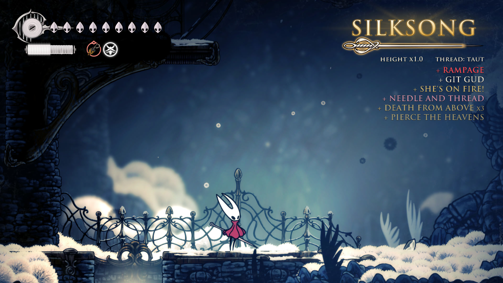
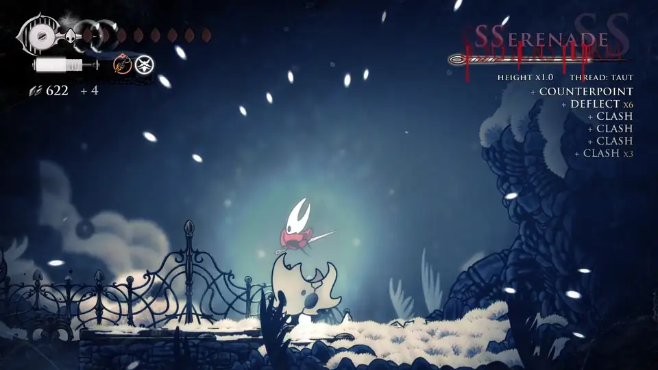
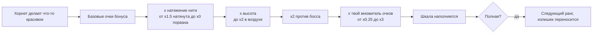
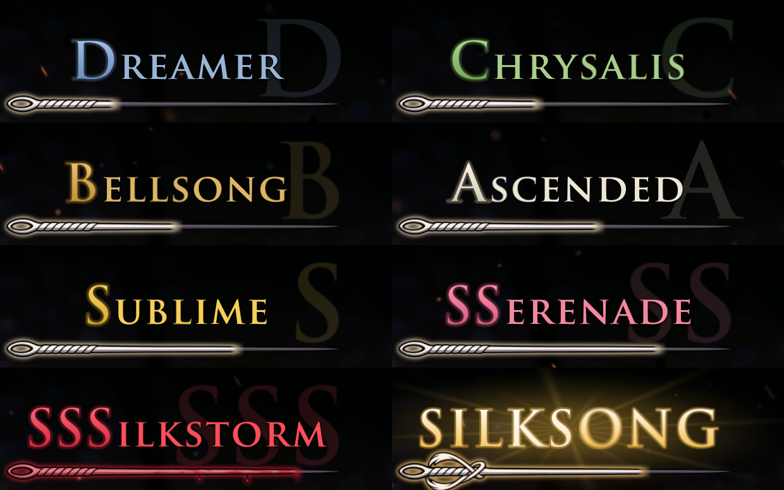
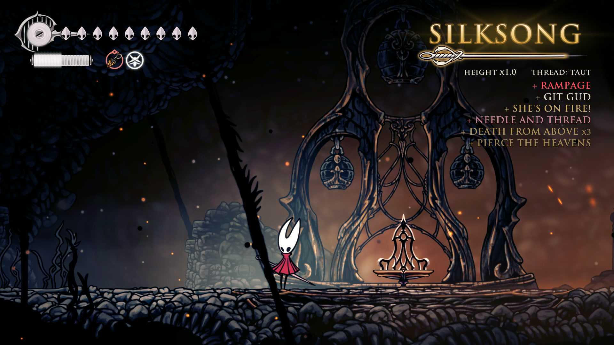
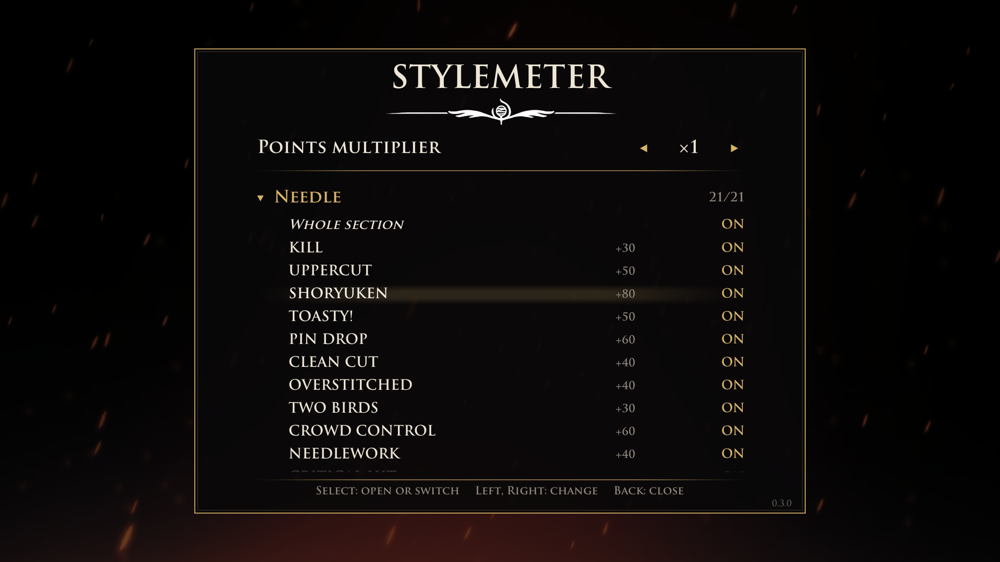

<p align="center">
  
</p>

<h1 align="center">Stylemeter</h1>

<p align="center">
  <b>Шкала стиля для Hollow Knight: Silksong.</b><br>
  Сражайся красиво и поднимайся через восемь рангов, от DREAMER до SILKSONG.
</p>

<p align="center">
  <a href="https://github.com/GlowyStar/silksong-stylemeter/releases"></a>
  
  
  <a href="https://github.com/GlowyStar/silksong-stylemeter/actions/workflows/ci.yml"></a>
  <a href="LICENSE"></a>
</p>

<p align="center">
  <a href="#установка">Установка</a> |
  <a href="#как-считаются-очки">Как считаются очки</a> |
  <a href="docs/BONUSES.md">Все бонусы</a> |
  <a href="#настройки">Настройки</a> |
  <a href="#вопросы">Вопросы</a> |
  <a href="README.md">English</a>
</p>

---

Stylemeter следит за тем, как сражается Хорнет, и оценивает это, как в слэшерах. Каждый удар, убийство, пого,
парирование, трюк с инструментом и победа над боссом это именной бонус. Чем разнообразнее и чаще, тем быстрее игла
в углу экрана наполняется и поднимает ранг. Повторяешь один приём, пропускаешь удары или стоишь на месте, и шкала
тает.

<p align="center">
  
  <br><sub>Настоящий бой на горе Фэй, сыгранный вручную: SSERENADE, брызги крови на SSSILKSTORM, вспышка на SILKSONG,
  удар разрезает его пополам, и снова SILKSONG.</sub>
</p>

> **Бета.** Всё описанное ниже работает и проверено в игре, а правила подсчёта очков покрыты автотестами. Игроков
> у мода пока мало, поэтому баланс ещё может меняться. Ошибки и идеи пишите в
> [Issues](https://github.com/GlowyStar/silksong-stylemeter/issues).

## Возможности

- **Около 250 именных бонусов в 14 разделах:** игла, воздух и движение, звон клинков и парирование, навыки шёлка,
  гребни, атакующие и защитные инструменты, Needolin, лечение, стихии и окружение, враги, своя победа над каждым
  боссом, мульти-убийства и комбинации, серии. [Полный каталог](docs/BONUSES.md) (на английском).
- **Натяжение нити.** Приём, который раз за разом приносит очки, изнашивает свою нить и платит меньше; смена иглы,
  инструментов и навыков держит все нити натянутыми.
- **Высота.** Каждое действие в воздухе поднимает множитель до x2, пока Хорнет не приземлится.
- **Боссы** удваивают любой бонус, у каждого босса своя именная победа.
- **Давление.** Пропущенный удар стоит ранга. Чем выше ранг, тем быстрее тает шкала; SILKSONG сгорает примерно за
  пять секунд, если его не кормить.
- **Награда за вершину:** одна единица шёлка за каждые пять секунд на SILKSONG (можно выключить).
- **Настройки прямо в игре:** панель в Настройках с множителем очков и переключателем для каждого бонуса.
- **Выглядит как часть игры:** рисованная игла, которая наполняется очками, названия рангов шрифтом игры,
  окровавленная игла на SSSILKSTORM и божественное сияние на SILKSONG. Два верхних ранга приходят и уходят
  по-своему: кровь у SSSILKSTORM, свет и разрез у SILKSONG.
- **Безопасно:** сохранения не трогаются, в сеть мод не выходит, а если обновление игры изменит то, что мод читает,
  выключится только зависящий от этого бонус.

## Как считаются очки



Не каждый бонус берёт все множители: действия (удары и убийства) берут все, приёмы (звон клинков, пого, связывания)
берут высоту и босса, но не изнашивают нить, а плоские бонусы (серии, зачистка арены) идут как есть.

| Нить | Когда | Платит |
|---|---|---|
| Натянута | свежая или отдохнула, пока очки приносили другие | x1.5 |
| Ослаблена | часто использовалась | x1 |
| Истрёпана | используется снова и снова | x0.5 |
| Порвана | ничего, кроме этого приёма | x0 |

Нити восстанавливаются со временем и каждый раз, когда очки приносит другая нить. Если способов сражаться всего
один или два, нить не опускается ниже уровня Ослаблена, если три или четыре, то ниже уровня Истрёпана, так что сборка с
малым числом инструментов не наказывается. Подробности со всеми числами в [docs/MECHANICS.md](docs/MECHANICS.md)
(на английском).

### Ранги



| Ранг | Очков до заполнения | Убывание в секунду |
|---|---|---|
| DREAMER | 200 | 7.2 |
| CHRYSALIS | 300 | 9.1 |
| BELLSONG | 400 | 11 |
| ASCENDED | 500 | 13 |
| SUBLIME | 700 | 26 |
| SSERENADE | 850 | 32.5 |
| SSSILKSTORM | 1000 | 44 |
| SILKSONG | 1500 | 300 |

В меню, роликах, диалогах, переходах между сценами и на скамейке шкала не убывает.

### Шкала на экране

- **Ранг** шрифтом игры, за ним крупная буквица.
- **Игла** наполняется в пределах текущего ранга; на SSSILKSTORM она в крови, на SILKSONG превращается в рапиру.
- **HEIGHT** показывает множитель высоты, **THREAD** натяжение нити последнего приёма.
- **Лента** показывает последние бонусы, новые сверху; повтор складывается в `x3`. Цвет говорит о базовых очках:
  белый до 100, золотой от 100, розовый от 200, красный от 300.
- **Два верхних ранга** приходят и уходят по-своему. SSSILKSTORM появляется с брызгами крови, а потерянный
  стекает кровью; SILKSONG вспыхивает светом, а потерянный разрезается слешем пополам, и половинки падают.

<p align="center">
  
</p>

### Немного из каталога

| Раздел | Некоторые бонусы (базовые очки) |
|---|---|
| Игла | PIN DROP 60, SHORYUKEN 80, INSULT TO INJURY 80, BIG KILL 100, TOASTY! 50 |
| Воздух и движение | POGO 15 каждое, HANG TIME 100, SKY HIGH 150, 1-UP 200, RUN, FORREST, RUN! 60 |
| Звон клинков и парирование | CLASH 50, RIPOSTE 150 |
| Гребни | OLD HABITS 80, CAT'S CRADLE 100 |
| Инструменты | BOOMERANG 60, TRICK SHOT 120, GLASS CANNON 150, DEATH DEFIANCE 200 |
| Стихии и окружение | KABOOM 45, THIS IS SPARTA! 150 |
| Враги | STOP, THIEF! 80, PARRY THIS! 100, THREAD THE NEEDLE 120 |
| Боссы | своя победа над каждым, до CUT THE CORD 1000; FLAWLESS VICTORY 400 |
| Мульти-убийства | DOUBLE KILL 50, TRIPLE KILL 100, ULTRAKILL 200, RAMPAGE 300 |
| Серии | ZERO TO HERO 300 и GIT GUD на случай, когда всё пошло не так |

Что нужно для каждого: [docs/BONUSES.md](docs/BONUSES.md).

## Настройки

В игре: **Настройки > Stylemeter**, из главного меню или из паузы. Панель на английском, как и названия бонусов.

<p align="center">
  
</p>

- **Points multiplier** (множитель очков) от x0.25 до x3: на него умножается каждое очко каждого бонуса. Меньше
  значит строже, больше значит высокие ранги чаще.
- Бонусы по разделам: открой раздел, чтобы переключать отдельные бонусы, или строкой **Whole section** весь
  раздел сразу.

Работает с геймпадом, клавиатурой и мышью, каждое изменение сохраняется сразу. Те же настройки лежат в
`BepInEx/config/com.glowystar.stylemeter.cfg`, вместе с этими:

| Настройка | По умолчанию | Что делает |
|---|---|---|
| `Meter.Enabled` | `true` | Считать очки стиля вообще |
| `Meter.ShowOverlay` | `true` | Показывать шкалу на экране |
| `Meter.SilkReward` | `true` | Шёлк за каждые пять секунд на SILKSONG |
| `Meter.PointsMultiplier` | `1` | То же, что в панели, от 0.25 до 3 |
| `Bonuses.Disabled` | пусто | Выключенные бонусы по имени, через `\|` |
| `Debug.LogStyle` | `true` | Писать бонусы и смену рангов в `BepInEx/Stylemeter/logs` |

## Установка

Нужны Hollow Knight: Silksong на Windows (проверено на версии из Steam) и
[BepInEx 5](https://github.com/BepInEx/BepInEx/releases), обычный загрузчик модов для игр на Unity.

1. **Найди папку игры.** В Steam: правой кнопкой по игре, **Управление > Просмотреть локальные файлы**. Это папка с
   `Hollow Knight Silksong.exe`.
2. **Поставь BepInEx 5.** Скачай `BepInEx_win_x64_5.4.23` или новее со страницы
   [релизов](https://github.com/BepInEx/BepInEx/releases) (сборка x64 версии 5, не 6), распакуй в папку игры и
   запусти игру один раз, чтобы BepInEx создал свои папки. Закрой игру.
3. **Поставь Stylemeter.** Скачай `Stylemeter-0.3.0.zip` со страницы
   [Releases](https://github.com/GlowyStar/silksong-stylemeter/releases) и распакуй в папку игры. Плагин окажется в
   `BepInEx/plugins/Stylemeter/Stylemeter.dll`.
4. **Играй.** Запусти игру: в Настройках появится пункт **Stylemeter**, а шкала покажется, как только Хорнет
   заработает первые очки.

Папка игры после этого выглядит так:

```text
Hollow Knight Silksong/
  Hollow Knight Silksong.exe
  winhttp.dll                 (от BepInEx)
  BepInEx/
    plugins/
      Stylemeter/
        Stylemeter.dll
```

Проверить загрузку можно по SHA-256: сравни с файлом `.sha256` рядом с архивом на странице релиза.

```powershell
Get-FileHash .\Stylemeter-0.3.0.zip -Algorithm SHA256
```

**Обновление:** распакуй новый архив поверх старого. **Удаление:** удали `BepInEx/plugins/Stylemeter` (и при
желании `BepInEx/config/com.glowystar.stylemeter.cfg` и `BepInEx/Stylemeter`).

## Вопросы

**Шкала не появляется.** Открой `BepInEx/LogOutput.log` и найди строку `Stylemeter 0.3.0 loaded`. Если её нет,
BepInEx не запускается: проверь, что `winhttp.dll` лежит рядом с exe игры. Если есть, проверь, что `Meter.Enabled`
и `Meter.ShowOverlay` равны `true`. Шкала скрыта, пока Хорнет не заработала очки.

**Мод меняет игру?** Добавляется только шкала. Единственное исключение: шёлк за SILKSONG, его можно выключить
(`Meter.SilkReward`). Сохранения мод не трогает.

**Достижения?** Работают как обычно.

**Другие моды?** Stylemeter перехватывает несколько методов игры через Harmony и должен уживаться с большинством
модов на BepInEx.

**Вышло обновление игры.** Если оно переименовало то, что читает мод, мод продолжит работать, выключит только
зависящие от этого бонусы и напишет в лог BepInEx, какие именно.

**Где журналы?** Каждая сессия пишет бонусы и смены рангов в `BepInEx/Stylemeter/logs`: десять последних сессий
там, более старые в `logs/old`, где хранится 200. Выключается `Debug.LogStyle = false`.

## Сборка из исходников

Нужны [.NET SDK](https://dotnet.microsoft.com/download) 10 и игра с BepInEx: плагин собирается против сборок самой
игры, а их в репозитории нет.

```powershell
./tools/build.ps1                              # Release и тесты подсчёта очков
./tools/build.ps1 -Install                     # и скопировать плагин в игру
./tools/build.ps1 -GameDir "D:\Games\Hollow Knight Silksong"
./tools/release.ps1                            # dist/Stylemeter-<версия>.zip и его SHA-256
```

`-Configuration Dev` собирает версию для разработки: слот-песочница, мост команд для автотестов и исследовательские
журналы. В Release ничего из этого нет.

| Папка | Что в ней |
|---|---|
| `src/Stylemeter/Core` | Движок очков: чистый C# без Unity, покрыт тестами |
| `src/Stylemeter/Game` | Хуки в игру, шкала на экране и панель настроек |
| `src/Stylemeter/Dev` | Инструменты разработки, только в сборке Dev |
| `src/Stylemeter.Sim` | Тесты правил движка: `dotnet run --project src/Stylemeter.Sim -c Release -- test` |

Версия задаётся в одном месте, `src/Directory.Build.props`.

## Авторы

- Мод и рисунок иглы: [GlowyStar](https://github.com/GlowyStar).
- Ранги, игла и награда шёлком сделаны в духе мира Silksong; сама идея шкалы стиля пришла из слэшеров.
- Hollow Knight: Silksong принадлежит Team Cherry. Мод с ними не связан и ими не одобрен.

## Лицензия

[MIT](LICENSE).
