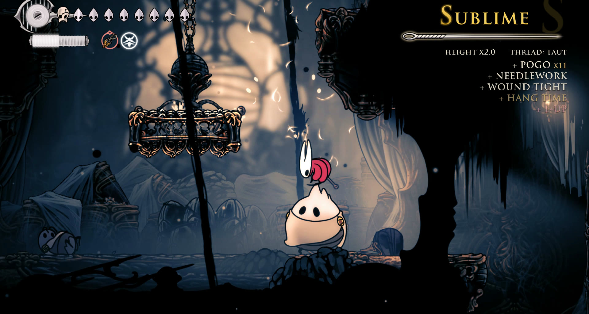

# Stylemeter

A style meter for Hollow Knight: Silksong. Fight with flair and climb eight ranks, from DREAMER to SILKSONG.

- **About 250 named bonuses in 14 sections:** needle work, air and movement, clashes and parries, silk skills,
  crests, tools, Needolin, healing, elements and the world, enemies, a named win for every boss, multikills, streaks.
- **Thread tension:** a move that keeps scoring pays less, so mixing needle, tools and skills pays best.
- **Height:** every scoring action in the air raises a multiplier up to x2 until Hornet lands.
- **Pressure:** getting hit costs a rank, and the higher the rank, the faster the meter drains.
- **The top two ranks** come and go in their own way: blood for SSSILKSTORM, light and a slash for SILKSONG.
- **A reward for holding the top:** one silk for every five seconds at SILKSONG (can be turned off).
- **Settings in the game:** Options > Stylemeter, with the points multiplier and a switch for every bonus.

Every bonus, how scoring works, a video and help: [github.com/GlowyStar/silksong-stylemeter](https://github.com/GlowyStar/silksong-stylemeter).

Hollow Knight: Silksong belongs to Team Cherry. This mod is not affiliated with or endorsed by them.
